# Design Document: AI SEO Expert in Nepal Landing Page
**Target URL:** `/ai-seo-expert-nepal.html`  
**Brand:** Bishal Oli | Founder & CEO, GrowZari  
**Target Search Intent:** Commercial Investigation / High-Intent Consultation  
**Target Query:** "AI SEO Expert in Nepal", "GEO Specialist Nepal", "AEO Consultant Kathmandu"  
**Date:** November 2026  

---

## 1. Executive Summary & Design Philosophy

The **AI SEO Expert in Nepal** landing page is engineered as a high-authority, conversion-focused asset that establishes Bishal Oli as Nepal’s premier consultant for next-generation search: traditional Organic SEO, Answer Engine Optimization (AEO), and Generative Engine Optimization (GEO).

### Core Design Principles:
1. **Radical Transparency over AI Hype:** Avoid fabricated statistics, fake ChatGPT screenshots, or guarantees of #1 AI rankings. Every metric, timeline, and deliverable is grounded in reality, verifiable client data, and observable search mechanics.
2. **Dual-Audience Optimization (Human & LLM):** Structured with semantic HTML5, clear entity associations, JSON-LD `@graph` schemas, and concise answer paragraphs that both human decision-makers and AI search bots (Perplexity, ChatGPT Search, Google AI Overviews) can easily parse, cite, and recommend.
3. **Interactive Decision Tools:** Includes interactive self-checks, expandable service cards, and transparent audit previews to make unfamiliar technical concepts immediately understandable and actionable.
4. **Visual Consistency:** Built strictly with GrowZari’s design system tokens: Deep Ink (`#071A33`), Royal Blue (`#1677FF`), Warm Gold (`#C9A96A`), Ivory (`#F7F4EE`), and Ice Blue (`#EAF3FF`), pairing `Manrope` for modern headings with `Inter` for crisp body typography.

---

## 2. Information Architecture & Page Flow

The page is architected into **20 discrete, logically progressive sections** mapped to the user's decision funnel:

```mermaid
flowchart TD
    S1["Section 1: Hero (Entity, Value Prop, CTAs)"] --> S2["Section 2: Trust Strip (Confirmable Proof)"]
    S2 --> S3["Section 3: The Business Problem (AI Search Gaps)"]
    S3 --> S4["Section 4: What Is an AI SEO Expert? (Definition)"]
    S4 --> S5["Section 5: SEO vs AEO vs GEO (Educational Matrix)"]
    S5 --> S6["Section 6: AI SEO Services (8 Expandable Cards)"]
    S6 --> S7["Section 7: 6-Stage Consulting Methodology"]
    S7 --> S8["Section 8: Verified Case Studies & Measurable Data"]
    S8 --> S9["Section 9: Why Choose Bishal Oli? (Differentiators)"]
    S9 --> S10["Section 10: Supported AI Search Platforms"]
    S10 --> S11["Section 11: Industries Served (Trekking, B2B, SaaS, etc.)"]
    S11 --> S12["Section 12: AI Visibility Audit Demonstration"]
    S12 --> S13["Section 13: Client Deliverables Matrix"]
    S13 --> S14["Section 14: Client Testimonials & Industry Authority"]
    S14 --> S15["Section 15: Engagement Models & Transparent Pricing"]
    S15 --> S16["Section 16: Measuring AI SEO & ROI (GSC, Bing, GA4)"]
    S16 --> S17["Section 17: Insights, Research & Practical Guides"]
    S17 --> S18["Section 18: Comprehensive FAQs (15 Questions)"]
    S18 --> S19["Section 19: High-Converting Consultation Booking Form"]
    S19 --> S20["Section 20: Expert Bio, NAP & Standardized Footer"]
```

---

## 3. Detailed Section-by-Section Specifications

### Section 1 — Hero: AI SEO Expert in Nepal
* **Priority:** Highest
* **Background:** `--color-ink-900` (Deep Ink)
* **Layout:** 2-column grid (`grid-hero`, 55% copy / 45% visual)
* **Content:**
  * **Badge:** `AI & GENERATIVE SEARCH OPTIMIZATION CONSULTANT` (Gold pill)
  * **H1:** `AI SEO Expert in Nepal – Grow Your Visibility Across Google & AI Search`
  * **Value Proposition:** *"Help customers discover your business through Google Search and AI-powered recommendations. I combine technical SEO, content strategy, Generative Engine Optimization, and measurable performance analysis to build stronger long-term search visibility."*
  * **Expertise Sentences:** *"Specializing in bridging classical search engineering with emerging Answer Engine Optimization (AEO) and Generative Engine Optimization (GEO). Based in Kathmandu, helping Nepali and international businesses dominate high-intent commercial search queries."*
  * **Location & Coverage:** Tarakeshwar, Kathmandu, Nepal • Serving clients across Nepal, USA, Australia, UK, and Europe.
  * **E-E-A-T Pill:** Google 5.0 ★★★★★ rating badge (23+ verified client reviews).
  * **CTAs:** 
    * Primary: `Book a Free Consultation` (Anchor to `#contact-form`)
    * Secondary: `See My Results` (Anchor to `#case-studies`)
  * **Visual Column:** High-resolution portrait of Bishal Oli in professional frame with subtle gold accent glow, accompanied by a genuine performance badge (e.g., `+2,172% Verified Search Growth`).

### Section 2 — Expert Credibility and Immediate Trust
* **Heading:** `Trusted SEO Expertise, Backed by Real Work`
* **Background:** `--color-ivory-50` with subtle border
* **Layout:** 6-item metrics trust strip + link
* **Evidence Cards:**
  1. **4+ Years Experience:** Confirmable timeline across Mindrisers, Splendour Group, One Percent Digital, and GrowZari.
  2. **100+ Projects Completed:** Global client delivery across Nepal, US, Australia, and UK.
  3. **2,172% Search Growth:** Real Search Console evidence for B2B manufacturing client.
  4. **Key Industries:** Trekking & Hospitality, B2B Manufacturing, Local Services, E-commerce, SaaS.
  5. **Verifiable Credentials:** Semrush Technical SEO, Google Generative AI, Search Atlas AI SEO.
  6. **Client Organizations:** Heaven Himalaya, Nepal Intrepid Treks, Native Nepal Dog Chew.
* **Micro-CTA:** Small text link: *"View Case Studies & Verified Results →"*

### Section 3 — Identify the Business Problem
* **H2:** `Your Customers Are Searching With AI. Can They Find Your Business?`
* **Lead Copy:** Explains the shifting search landscape in familiar terms—buyers asking conversational questions to ChatGPT, Perplexity, and Google AI Overviews rather than just typing 2-word keywords.
* **H3 Subsections (5 Problem Scenarios):**
  1. *Your competitors are being discovered instead of you* — AI models recommending rivals because of clearer digital entity footprints.
  2. *Your website attracts traffic but struggles to generate qualified leads* — Ranking for generic keywords that fail to capture buyer intent.
  3. *Your business information is inconsistent or incomplete* — Fragmented NAP, missing schema, and conflicting details confusing AI crawlers.
  4. *Your content doesn't answer customers' important buying questions* — Missing specific pricing, comparative factors, and execution details.
  5. *You cannot measure how your brand appears in AI-generated answers* — Zero visibility into AI citations, referral traffic, and brand impressions.
* **Interactive Element: AI Readiness Self-Check**
  * 3 quick evaluation questions with Yes/Partial/No interactive buttons:
    1. *Can customers find your business when asking conversational questions in ChatGPT or Perplexity?*
    2. *Are your services, pricing criteria, and differentiators explicitly structured for search crawlers?*
    3. *Are you measuring brand impressions and citations inside Google's Generative AI reports?*
  * Dynamic result badge providing instant diagnostic feedback + CTA button: `Find Out Where Your Business Stands`.

### Section 4 — What Is an AI SEO Expert?
* **H2:** `What Is an AI SEO Expert in Nepal?`
* **Opening Definition Box:**
  > *"An AI SEO expert in Nepal is a search optimization professional who helps businesses improve discoverability across traditional search engines and AI-powered search experiences. The work combines technical SEO, authoritative content, clear brand information, and measurement to improve how search systems find and represent a business."*
* **Content Columns (4 Concise Subsections, 200 words total):**
  * *What does an AI SEO expert actually do?* — Audits brand visibility in AI answers, structures site data for machine ingestion, builds topical clusters, and fixes crawler accessibility.
  * *How does AI SEO differ from traditional SEO?* — Traditional SEO optimizes for 10 blue links; AI SEO optimizes for synthesis, citations, direct answers, and entity authority.
  * *Why should Nepali businesses consider AI search optimization?* — Tourism, trekking, and exporters rely on global buyers who increasingly plan trips and select vendors via AI search.
  * *How does an AI SEO consultant use AI tools responsibly?* — AI is leveraged for research, analysis, and data mapping; strategy, factual validation, and technical execution remain strictly human-led.
* **Educational Link:** Direct link to `/blogs.html` and `/glossary.html` for deep-dive tutorials.

### Section 5 — Explain SEO, AEO, and GEO
* **H2:** `SEO vs AEO vs GEO: Understanding Modern Search Optimization`
* **H3:** `Why You Need an Integrated SEO and AI Search Strategy`
* **Comparison Matrix (Responsive Table & Visual Cards):**

| Approach | Primary Focus | Technical Mechanism | Business Application |
| :--- | :--- | :--- | :--- |
| **SEO** (Search Engine Optimization) | Organic Search Visibility | Crawlability, indexing, keywords, backlinks | Help service pages rank and earn steady organic search traffic |
| **AEO** (Answer Engine Optimization) | Direct, Accessible Answers | Clear entity data, FAQ structures, conversational schema | Address specific customer buying questions across voice and quick answers |
| **GEO** (Generative Engine Optimization) | Generative Model Synthesis | Authority sources, citations, semantic context | Maximize brand inclusion, accurate citations, and recommendations in LLMs |
| **AI SEO** (Unified Modern Search) | Complete Ecosystem Discoverability | Technical foundation + Entity authority + Content quality | Future-proof your business across Google, ChatGPT, Perplexity, and Bing |

### Section 6 — Core AI SEO Services (8 Expandable Cards)
* **H2:** `AI SEO Services in Nepal: What I Can Help You Improve`
* **Subtitle:** Practical, deliverable-driven services designed for measurable search and generative visibility.
* **Card Architecture:** Expandable accordion/toggle with value prop, bulleted deliverables, and business benefits:
  1. **AI Search Visibility Audit**  
     *Deliverables:* Prompt inventory, visibility benchmark, competitor gap assessment, prioritized audit report.  
     *Benefit:* Know exactly where your brand stands in AI responses today.
  2. **Technical SEO and AI Search Accessibility**  
     *Deliverables:* Robots.txt crawler permissions (GPTBot, PerplexityBot, etc.), rendering audit, schema validation, server response fixes.  
     *Benefit:* Ensure modern search engines and AI agents can seamlessly read and index your pages.
  3. **AEO and Answer-Focused Content Optimization**  
     *Deliverables:* Question-driven content briefs, rewritten high-priority service sections, factual reference lists.  
     *Benefit:* Capture zero-click and direct-answer queries before your competitors do.
  4. **GEO and Brand Entity Optimization**  
     *Deliverables:* Entity audit, Wikidata/SameAs alignment, digital footprint cleanup, authority-building plan.  
     *Benefit:* Establish your brand as an undisputed entity in Google's Knowledge Graph.
  5. **Topical Authority and Content Strategy**  
     *Deliverables:* Comprehensive keyword and question maps, topic cluster blueprints, prioritized editorial calendar.  
     *Benefit:* Become the definitive industry resource so search algorithms recognize your subject mastery.
  6. **Digital PR, Brand Mentions, and Reputation**  
     *Deliverables:* Unlinked brand mention audit, verified citation profiles, industry guest outreach recommendations.  
     *Benefit:* Provide independent external corroboration that AI models require for source citations.
  7. **Local AI SEO for Nepal Businesses**  
     *Deliverables:* Google Business Profile optimization, local citation cleanup, localized landing page structuring.  
     *Benefit:* Dominate Google Maps and local AI queries from international travelers and local buyers.
  8. **AI Search Monitoring and Analytics**  
     *Deliverables:* Custom KPI dashboard, Google Search Console AI feature tracking, monthly performance reviews.  
     *Benefit:* Measure real business leads, not just speculative AI mentions.

### Section 7 — Transparent 6-Stage Methodology
* **H2:** `How I Help Businesses Improve Search and AI Visibility`
* **Interactive Process Flow:**
  1. **Discovery & Baseline Assessment** → *Deliverable: Baseline Report*  
     Examine business model, buyer personas, target markets (Nepal vs International), and existing performance.
  2. **Technical & Authority Audit** → *Deliverable: Complete Technical & Entity Audit*  
     Diagnose crawl barriers, schema gaps, brand ambiguities, and competitor visibility.
  3. **Strategy & Prioritization** → *Deliverable: 90-Day Implementation Roadmap*  
     Distinguish urgent fixes from high-value content and long-term authority assets.
  4. **Implementation & Content Improvement** → *Deliverable: Validated Code & Optimized Pages*  
     Implement structured data, rewrite core commercial answers, and optimize internal links.
  5. **Visibility & Conversion Measurement** → *Deliverable: Multi-Platform Analytics Dashboard*  
     Set up tracking in GA4, Search Console (including Generative AI reports), and Bing Webmaster.
  6. **Continuous Testing & Refinement** → *Deliverable: Monthly Performance Reviews*  
     Iterate based on model algorithm updates, crawler behavior shifts, and real inquiry rates.
* **CTA Button:** `Discuss My AI SEO Strategy`

### Section 8 — Case Studies & Measurable Results
* **H2:** `Real SEO Results and AI Search Visibility Case Studies`
* **Structure:** Clean before-and-after cards with transparent timelines, verified sources, and distinct correlation notes:
  * **Case Study 1: Native Nepal Dog Chew (B2B Manufacturing)**  
    *Challenge:* Established exporter struggling with international organic discovery and buyer inquiries.  
    *Strategy:* Semantic SEO topical cluster around Himalayan yak dog chews, B2B intent landing pages, and international technical indexing.  
    *Result:* **+2,172% Organic Traffic Growth** in 7 months; verified multi-country wholesale inquiries.  
    *Data Source:* Google Search Console (Feb 2025 – Aug 2026).
  * **Case Study 2: Nepal Intrepid Treks (Trekking & Adventure Tourism)**  
    *Challenge:* High competition for Everest and Annapurna commercial routes against legacy travel portals.  
    *Strategy:* Entity architecture, itinerary answer optimization (AEO), and high-intent route guide authority.  
    *Result:* **3X (Tripled) Organic Qualified Leads & Bookings** in 5 months.  
    *Data Source:* GA4 Goal Conversions & CRM records.
  * **Case Study 3: Local Service & E-Commerce Growth**  
    *Challenge:* Inconsistent local presence and low transaction velocity.  
    *Strategy:* Local GEO structuring, review entity alignment, and conversion rate optimization.  
    *Result:* **+270% Organic Traffic Growth and Doubled Lead Volume** in 6 months.

### Section 9 — Why Choose Bishal Oli?
* **H2:** `Why Choose Bishal Oli as Your AI SEO Consultant in Nepal?`
* **First-Person Narrative:** Direct, grounded, and personal commitment to client success.
* **6 Pillars of Differentiation:**
  1. *First-hand implementation experience* — I execute the technical and strategic work myself; no junior outsourcing.
  2. *Combined technical, content, and authority mastery* — Not just writing blog posts, but configuring servers, schemas, and semantic data models.
  3. *Deep understanding of Nepal's commercial landscape* — Expert in navigating both local Nepali buying habits and international export/tourism markets.
  4. *Commercially focused outcomes* — Measuring pipeline revenue and qualified inquiries rather than vanity impressions.
  5. *Direct founder-level involvement* — You communicate directly with the lead consultant throughout the engagement.
  6. *Honest expectations* — No fake guarantees of algorithmic permanence or guaranteed AI citations.
* **Comparison Matrix:** "Standard Freelancer / Agency" vs "My Consultancy Approach".

### Section 10 — Supported AI Search Platforms
* **H2:** `Search Experiences I Optimize and Monitor`
* **6 Platform Cards:**
  1. **Google Search + AI Overviews:** Technical indexing, eligible source appearances, and Google Search Console Generative AI tracking.
  2. **ChatGPT Search:** Brand entity clarity, OpenAI crawler permissions (GPTBot), and referral session tracking.
  3. **Perplexity:** Citation-focused source integration, academic/factual corroboration, and competitive brand positioning.
  4. **Bing + Microsoft Copilot:** IndexNow fast-indexing, Bing Webmaster AI Performance reporting, and linked entity schemas.
  5. **Google Gemini:** Google ecosystem knowledge alignment, YouTube & Google Maps entity corroboration.
  6. **Emerging AI Search Engines:** Monitoring SearchGPT, Claude artifacts, and localized search bots without treating them as identical clones.

### Section 11 — Industries Served
* **H2:** `AI SEO Solutions for Businesses in Nepal and International Markets`
* **6 Interactive Industry Cards with Illustrative Buyer Prompts:**
  1. **Trekking & Tourism:** *"Which trekking company in Nepal is best for a private Everest Base Camp trek?"*
  2. **Hotels & Hospitality:** *"Which boutique hotels in Kathmandu are suitable for international travelers?"*
  3. **Education Consultancies:** *"Which education consultancy in Nepal helps students apply to Australia?"*
  4. **B2B Manufacturing & Export:** *"Reliable wholesale manufacturers of authentic Himalayan dog chews in Nepal."*
  5. **SaaS & Technology:** *"What are top-rated custom software and IT development partners in South Asia?"*
  6. **E-Commerce:** *"Authentic handmade pashmina and artisanal goods shipped internationally from Nepal."*

### Section 12 — AI Visibility Audit Demonstration
* **H2:** `Find Out How AI Search Currently Represents Your Business`
* **Interactive Sample Audit Teaser:** Shows prospective clients what an AI visibility diagnostic looks like:
  * Prompt Coverage Sample (`"Best B2B SEO services in Nepal"`)
  * Competitor Co-occurrence Matrix
  * Source Attribution URLs
  * Factual Accuracy Audit (Checking phone, address, founder, and core services across LLMs)
  * Priority Action Plan
* **CTA Box:** Free Initial Diagnostic Assessment (defining clear scope: 3-5 high-priority commercial prompts reviewed).

### Section 13 — Client Deliverables Matrix
* **H2:** `What Will You Receive From an AI SEO Engagement?`
* **Clean Deliverables Grid:** Outlining tangibles from Initial Audit, Opportunity Maps, Technical Architecture, Content Briefs, Authority PR Plans, to Monthly GSC AI Reports.

### Section 14 — Client Testimonials & Third-Party Trust
* **H2:** `What Clients Say About Working With Me`
* **Verifiable Attributions:**
  * **Ramhari Adhikari (Heaven Himalaya):** Authentic feedback on SEO recovery and patient, structured guidance.
  * **Lal Gurung (Nepal Intrepid Treks):** Proven results on lead generation and high-value bookings.
  * **Dhurba Raj Regmi (Native Nepal Dog Chew):** Transformative B2B growth and hands-off SEO leadership.
* **Authority Contributions Strip:**
  * Featured Speaker at *DevOps Connect Pokhara* (2025).
  * Winner of *AI SEO Content Writing Award (2025)* at SEO Conference Nepal.
  * Author of *AI SEO for Beginners* and *SEO for Trekking Businesses*.

### Section 15 — Engagement Models & Pricing Transparency
* **H2:** `AI SEO Consulting Services and Engagement Options`
* **3 Tier Cards (Custom Quotation with Clear Scope):**
  1. **Diagnostic Audit & Roadmap** — Baseline assessment, prompt inventory, technical crawler audit, 90-day action plan.
  2. **Implementation Project** — Hands-on technical schema implementation, core landing page AEO restructuring, entity disambiguation.
  3. **Ongoing Advisory & Growth** — Monthly generative monitoring, content cluster expansion, external citation building, reporting.
* **Pricing Transparency Note:** Custom quotes based on site complexity, market competition, and target international geography. No cheap shortcut packages or fake guarantees.

### Section 16 — Measuring Performance & ROI
* **H2:** `How Do I Measure AI SEO Results?`
* **4-Tier Measurement Hierarchy:**
  1. *Organic Visibility:* Search Console clicks, impressions, keyword rankings.
  2. *Generative Search Visibility:* Google Search Console Generative AI reports, Bing AI citation metrics, brand prompt inclusion frequency.
  3. *User Acquisition:* Verified AI referral traffic, engaged user sessions in GA4.
  4. *Commercial Business Impact:* Qualified phone/WhatsApp calls, consultation bookings, CRM revenue.
* **H3 Subsection:** *How Long Does AI SEO Take to Show Results?* (Technical fixes: 2-4 weeks; Entity indexing: 6-12 weeks; Authority citations: 3-6 months).

### Section 17 — Insights, Research & Practical Guides
* **H2:** `AI SEO Insights, Research, and Practical Guides`
* **4 Curated Guides:**
  1. *What Is AI SEO? A Practical Guide for Businesses in Nepal*
  2. *AEO vs GEO vs SEO: What Is the Difference?*
  3. *How to Measure AI Search Visibility and Citations (2026 Edition)*
  4. *How Nepali Businesses Can Prepare for AI-Powered Search*

### Section 18 — Frequently Asked Questions (15 Questions)
* **H2:** `Frequently Asked Questions About AI SEO in Nepal`
* **Format:** Clean accessible accordion with full answer text:
  1. Who is an AI SEO expert in Nepal?
  2. What does an AI SEO consultant do?
  3. What is the difference between AI SEO and traditional SEO?
  4. What is Generative Engine Optimization (GEO)?
  5. What is Answer Engine Optimization (AEO)?
  6. Can AI SEO help my business appear in ChatGPT Search?
  7. How can I improve visibility in Google AI Overviews?
  8. Can an SEO consultant guarantee AI citations?
  9. How much do AI SEO services cost in Nepal?
  10. How long does AI SEO take to work?
  11. Can small businesses in Nepal benefit from AI search optimization?
  12. Do I need a new website for AI SEO?
  13. How do you measure citations, AI impressions, and leads?
  14. Do you offer AI SEO services to international clients?
  15. Is AI SEO suitable for trekking, tourism, and hospitality businesses?
* **2026 Technical Guidance:** Explicitly notes that Google retired the FAQ rich-result feature in May 2026; FAQs are included for user clarity, direct answer extraction, and semantic relevance, not for rich snippet shortcuts.

### Section 19 — Final Conversion Section
* **H2:** `Ready to Improve Your Visibility on Google and AI Search?`
* **Subheading:** *"Tell me about your business, target customers, and current search challenges. We'll review the opportunities and identify an appropriate next step."*
* **Conversion Block:**
  * Clean consultation booking form (Name, Email, Website URL, Business Type, Primary Challenge).
  * Direct contact options: WhatsApp (`+977 9866735560`), Email (`bishaloli610@gmail.com`).
  * Expected response: Within 24 business hours. No artificial timers or countdowns.

### Section 20 — Expert Identity, Location, and Global Footer
* **Heading:** `About Bishal Oli, AI SEO Consultant in Nepal`
* **Content:** Short bio emphasizing GrowZari leadership, Tarakeshwar Kathmandu location, verified social profiles, and links to `/about.html`, `/seo-expert-nepal.html`, and `/work-with-me.html`.
* **Standard Footer:** Rendered dynamically via `js/components/footer.js`.

---

## 4. Technical SEO, JSON-LD Schema & Metadata

### On-Page Meta Tags:
* **Title:** `AI SEO Expert in Nepal | Bishal Oli — Generative Engine & AI Search Optimization`
* **Description:** `Bishal Oli is an AI SEO Expert in Nepal specializing in Generative Engine Optimization (GEO), Answer Engine Optimization (AEO), and Semantic SEO to grow business visibility across Google and AI search.`
* **Canonical:** `https://bishaloli.com/ai-seo-expert-nepal.html`
* **OpenGraph & Twitter Cards:** Full metadata with high-res portrait image and target descriptions.

### JSON-LD Schema Architecture (`@graph`):
1. **`Person` Schema:** Bishal Oli (`@id: https://bishaloli.com/#person`) with all verified `sameAs` links (Facebook, LinkedIn, YouTube `@rambknows`, Instagram, X, TikTok).
2. **`Organization` Schema:** GrowZari (`@id: https://bishaloli.com/#organization`).
3. **`ProfessionalService` Schema:** Specific service node for "Bishal Oli — AI SEO Expert in Nepal".
4. **`Service` Schema:** "AI SEO, GEO & AEO Consulting Services".
5. **`BreadcrumbList` Schema:** `Home` → `Services` → `AI SEO Expert in Nepal`.
6. **`WebPage` Schema:** Target URL with primary entity references.

---

## 5. Responsive Design & Accessibility

* **Mobile-First Breakpoints:**
  * Mobile: `< 640px` (Single column, full width cards, horizontal touch scrolling for tables)
  * Tablet: `640px - 1024px` (2-column grids)
  * Desktop: `> 1024px` (Max width 1200px container, multi-column layouts)
* **Accessibility (WCAG 2.1 AA):**
  * All interactive elements have accessible names and keyboard focus outlines.
  * Contrast ratio > 4.5:1 for body copy and > 3:1 for large headings.
  * Native `
` or ARIA-expanded accordions.
